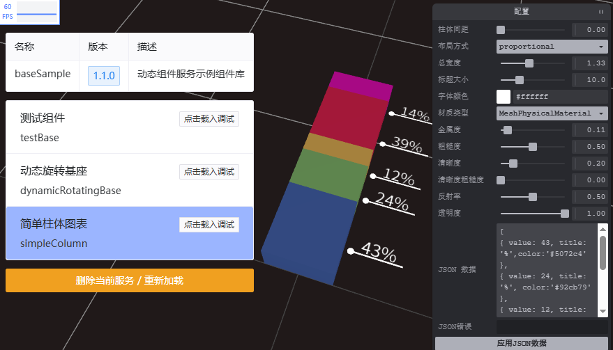

# dynamic-component-service（loadDynamicComponent）

> 基于 **tvt.js** 生态的动态组件发布与加载服务
> Dynamic Component Service for tvt.js

> 点击下方 👇🏻 预览地址：https://dcser.icegl.cn
<a style="display:block;width:800px;max-width:100%;" href="https://dcser.icegl.cn"></a>

📦 项目地址：
👉 [https://gitee.com/ice-gl/dynamic-component-service](https://gitee.com/ice-gl/dynamic-component-service)

## ✨ 持续打通多个生态
* 🌈 tvt.js 开源基座
  👉 [https://opensource.icegl.cn/#/plugins/loadDynamicComponent/readConfig](https://opensource.icegl.cn/#/plugins/loadDynamicComponent/readConfig)
* 🏞️ 区域三维场景编辑器
  👉 [https://zone3deditor.icegl.cn/#/plugins/zone3Deditor/index](https://zone3deditor.icegl.cn/#/plugins/zone3Deditor/index)
* 🗺️ GIS地理空间编辑器
  👉 [https://gisplaneeditor.icegl.cn/#/plugins/gisPlaneEditor/index](https://gisplaneeditor.icegl.cn/#/plugins/gisPlaneEditor/index)
---

## ✨ 项目简介

**dynamic-component-service（loadDynamicComponent）**
是 **tvt.js 生态下的一套动态组件发布、加载与调试解决方案**。

它的核心目标是：
让 **自研或第三方组件** 可以 **脱离 tvt.js 开源基座独立维护**，
同时又能被 **tvt.js 在线编辑器动态加载**，获得完整编辑能力，并支持源码导出与二次开发。

---

## 🏁 里程碑

这次项目实践有一个很重要的意义：
**dynamic-component-service 不再只是一个组件发布容器，而开始成为一个可以通过 AI + OpenSpec 持续演进的组件工程体系。**

这意味着后续新增组件、修改组件、补充能力、调整规则，不再依赖“先想好再手工慢慢改”的单线程方式，而是可以进入一套更稳定的协作闭环：

* **OpenSpec 负责定义变更**
* **AI 负责实现与联调**
* **README / config / 规则文件负责沉淀方法论**

从这一步开始，项目的价值不只是“有多少组件”，而是：
**是否已经具备一套可重复、可积累、可持续放大的组件生产方式。**

---

## 🎯 设计目的

### 1️⃣ 解耦商业组件与 tvt.js 基座

* 一些开发者的组件属于 **商业项目**
* 不希望直接提交到 **tvt.js 开源仓库**
* 希望组件 **独立发布、独立部署**
* 但在生产项目中，仍然可以通过 **tvt.js 基座动态加载并使用**

👉 dynamic-component-service 提供了一种 **解耦但可集成** 的方案。

---

### 2️⃣ 动态组件 + 在线编辑 + 源码导出

* 将 **自研或第三方代码** 简单封装成「动态组件」
* 挂载到 **tvt.js 在线三维场景编辑器**
* 自动获得：

  * 组件参数可视化配置
  * 与现有 **高级组件 / 模型库 / 场景系统** 联动
* 支持：

  * 在线调试与预览
  * 导出组件配置
  * **直接导出插件源码包**
  * 在 tvt.js 基座中进行 **二次开发**

---

## 🧱 技术栈说明

| 技术                                   | 说明                   |
| ------------------------------------ | -------------------- |
| **Vue 3**                            | tvt.js 生态整体基于 Vue 3  |
| **@originjs/vite-plugin-federation** | 动态组件发布与加载的核心机制       |
| **Three.js**                         | 三维渲染基础               |
| **Tres.js**                          | Vue + Three.js 的桥接方案 |
| **@tresjs/cientos**                  | 常用 Three.js 高级组件集合   |

---

### 关于 vite-plugin-federation

本项目通过
**@originjs/vite-plugin-federation**
实现动态组件的 **发布 / 远程加载 / 模块共享**。

* 官方文档：
  👉 [https://www.npmjs.com/package/@originjs/vite-plugin-federation](https://www.npmjs.com/package/@originjs/vite-plugin-federation)
* 本项目中：

  * 已完成 federation 默认配置
  * tvt.js 开源基座中也已配置好对应加载逻辑
  * 只需简单配置，即可完成 **组件互通**

---

## 🚀 快速开始

### 环境要求

* Node.js（推荐 LTS）
* Yarn

---

### 获取代码

```bash
git clone https://gitee.com/ice-gl/dynamic-component-service
cd dynamic-component-service
```

---

### 安装依赖

```bash
yarn
```

---

### 常用命令说明

#### 🔧 本地开发（仅调试）

```bash
yarn dev
```

> ⚠️ **注意**
> federation 动态组件机制 **不支持 dev 模式发布服务**
> `dev` 仅用于本地组件页面调试

---

#### 📦 构建组件服务

```bash
yarn build
```

构建完成后，可将产物部署到自己的服务器。

**注意事项：**

1. 当前版本仅支持 **域名根目录部署**
2. 请注意 **HTTP / HTTPS 跨域问题**

   * 建议提前了解 Web 服务跨域配置（CORS）

---

#### 👀 本地预览（推荐）

```bash
yarn preview
```

* 默认端口：`5000`
* 启动后即可作为 **完整的动态组件服务**

可将该地址配置到：

* tvt.js 开源基座
  👉 [https://opensource.icegl.cn/#/plugins/loadDynamicComponent/readConfig](https://opensource.icegl.cn/#/plugins/loadDynamicComponent/readConfig)
* 区域三维场景编辑器
  👉 [https://zone3deditor.icegl.cn/#/plugins/zone3Deditor/index](https://zone3deditor.icegl.cn/#/plugins/zone3Deditor/index)
* GIS地理空间编辑器
  👉 [https://gisplaneeditor.icegl.cn/#/plugins/gisPlaneEditor/index](https://gisplaneeditor.icegl.cn/#/plugins/gisPlaneEditor/index)
用于 **调试 / 编辑 / 开发**。

---

#### 🔁 热更新服务（推荐开发方式）

```bash
yarn serve
```

等价于：

```text
yarn build + yarn preview（带监听）
```

* 文件改动自动重新编译
* 本地 5000 端口实时更新组件服务

---

## 🤖 AI + OpenSpec 协作方式

这部分方法论已经拆到独立文档，避免 README 过长：

👉 [AI_OPENSPEC_WORKFLOW.md](./AI_OPENSPEC_WORKFLOW.md)

文档中包含：

* 推荐协作流程
* 推荐时间节奏
* 如何把一次实践沉淀为项目资产

---

## 📜 项目宪法规则

下面这些规则不是针对某一次需求，而是后续基于这个项目继续新增和修改组件时，都应该默认遵守的规则。

### 1. 通用预览层非必要不改

以下文件属于 **通用预览基础设施**：

* `src/views/previewEntry.vue`
* `src/views/templateComponet.vue`

非必要不要改动。

组件预览接入、默认参数和调参配置，应优先通过：

* `src/dcsConfig.ts`

来完成，而不是把单个组件逻辑侵入公共视图层。

---

### 2. Shader 必须独立管理

所有组件相关 shader，统一放在：

* `src/shader/<组件名>/`

目录下，并至少拆分为：

* 顶点着色器
* 片元着色器

不要把较长的 shader 代码直接内联在 Vue 组件中。

---

### 3. 组件能力优先保持 three.js / tresjs 语义

`src/components` 下的组件默认是 **three.js / tresjs 三维组件**，
不是普通 DOM/CSS 组件。

如果一个需求本质上是三维渲染能力，就应优先通过：

* geometry
* material
* shader
* line / mesh / group

这些 three.js 语义来实现。

---

### 4. 新增参数时，同步维护 default 与 config

只加 props 还不够。

如果组件是要进入动态组件服务体系的，那么新增参数时，至少要同步维护：

* 组件默认参数
* `dcsConfig.ts` 中的 `default`
* `dcsConfig.ts` 中的 `config`

这样它才能真正进入“可预览、可调参、可发布”的完整链路。

---

## 📂 项目结构说明

```text
├── public/                 # 静态资源 & 组件预览图
├── src/
│   ├── common/             # 公共工具函数
│   ├── components/         # 动态组件目录
│   │   ├── common/         # 公共组件
│   │   └── simpleColumn/   # 示例组件目录（可自定义）
│   │       └── dynamicRotatingBase.vue
│   ├── shader/             # 组件 shader 目录（按组件名分目录）
│   ├── router/             # 路由配置
│   │   ├── componentList   # 服务说明 & 组件列表
│   │   └── previewEntry    # 单组件预览调试
│   └── dcsConfig.ts        # ⭐ 动态组件核心配置文件
├── ...
```

> 其余文件均为标准 Vue 3 + Vite 项目结构，
> 并已按 `vite-plugin-federation` 要求完成配置。

---

## ⚙️ dcsConfig.ts 配置详解（核心）

./src 目录下的 `dcsConfig.ts` 是 **整个动态组件服务的核心配置文件** 原则上增加/修改完组件代码后，再更改`dcsConfig.ts`即可发布服务。

---

如下为参考实例：
```ts
const config = {
  name: 'baseSample',
  version: '1.1.0',
  description: '动态组件服务示例组件库',
  components: [
    {
      name: '测试组件',
      type: 'testBase',
      comFile: './src/components/testBase.vue',
      previewPath: './preview/testBase.png',
      default: {},
      defaultObject3D: {},
      config: {},
    },
	...
  ]
}
```

---

### 基础字段

```ts
name: string        // 动态组件服务名称（仅支持英文）
version: string     // 服务版本号
description: string // 服务描述
```

---

### components（组件列表）

```ts
components: [
  {
    name: string
    type: string
    comFile: string
    previewPath: string
    defaultObject3D?: { ... }
    default?: { ... }
    config?: { ... }
  }
]
```

---

### 单个组件字段说明

#### 🧩 基础信息

| 字段            | 说明       |
| ------------- | -------- |
| `name`        | 组件名称     |
| `type`        | 组件唯一英文标识 |
| `comFile`     | 组件入口文件   |
| `previewPath` | 组件预览图路径  |

---

#### 🎯 defaultObject3D（可选）

默认 Three.js 物体参数（**仅支持** 位置 / 缩放 / 旋转）：

```ts
defaultObject3D: {
  position: { x: 0, y: 0.2, z: 0 },
  scale: { x: 0.5, y: 0.5, z: 0.5 },
  rotation: { x: -Math.PI / 2, y: 0, z: 0 },
}
```

> 可只写其中任意项，或完全不写。

---

#### 🔧 default（组件默认参数）

```ts
default: {
  color: '#ffffff',
  opacity: 1,
  // ...其他自定义参数
}
```

---

#### 🎛 config（参数 UI 配置）

> 将自动生成 **在线编辑器配置面板**

⚠️ 字段通常需要与 `default` 一一对应。

`ActionButton` 属于动作型 metadata，不要求在 `default` 中提供同名字段。

```ts
config: {
  color: { name: '颜色', com: 'ColorPicker' },

  type: {
    name: '类型',
    com: 'Select',
    options: ['imgA', 'imgB', 'imgC'].map(item => ({
      label: item,
      value: item,
    })),
  },

  videoLoop: { name: '视频重复', com: 'Switch' },

  opacity: {
    name: '透明度',
    com: 'Slider',
    min: 0,
    max: 1,
    step: 0.01,
  },

  jsonText: {
    name: '数据配置',
    com: 'jsonText',
  },

  randomizeAction: {
    name: '随机树木配置',
    com: 'ActionButton',
    action: 'randomizeTreeConfig',
  },
}
```

---

### 当前支持的 UI 组件类型

| com           | 说明       |
| ------------- | -------- |
| `ColorPicker` | 颜色选择器    |
| `Select`      | 下拉选择     |
| `Switch`      | 开关       |
| `Slider`      | 数值滑动条    |
| `jsonText`    | JSON 编辑器 |
| `ActionButton` | 动作按钮     |

---

## 🧩 总结

dynamic-component-service 是：

* tvt.js 生态下的 **动态组件基础设施**
* 实现：

  * 组件独立发布
  * 动态加载
  * 在线编辑
  * 源码导出
  * 二次开发
* 面向：

  * 商业项目
  * 插件作者
  * 三维应用开发者
* 同时也是：

  * 一个可以通过 **AI + OpenSpec 持续演进** 的组件工程体系
  * 一个可以不断沉淀“规则、结构、方法论”的项目底座

---
